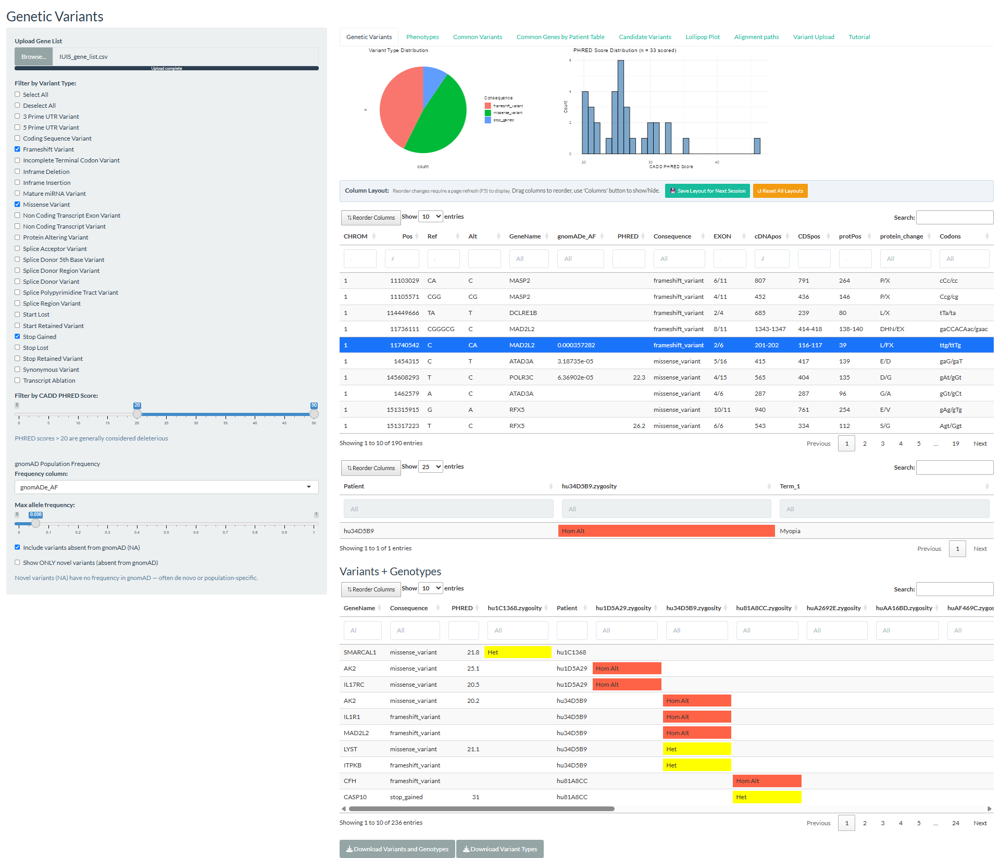

# Genetic Variant Explorer

A Shiny web application for interactive browsing, filtering, and curation of annotated genetic variant data across multi-sample/family cohorts.
For detailed instructions on download installation and setting up your own database, or using the test data, please see SETUP_GUIDE.md and APP_GUIDE.md file under the app folder.

---
<p align="center">
  
</p>
## Features

- **Variant browsing** — filter by consequence type, CADD PHRED score, and gene list; live pie chart and PHRED histogram update with filters
- **Multi-sample analysis** — find variants shared across selected patients/families; gene-level table identifies genes with variants in more than one patient
- **Phenotype integration** — filter patients by HPO/phenotype terms; phenotype table is editable in-app
- **Lollipop plots** — gene-level variant visualisation mapped to protein domains fetched live from Ensembl/BioMart or Uniprot
- **Candidate variant curation** — capture variants from any table into a persistent review list with editable notes and custom columns
- **Variant upload** — upload annotated TSV/CSV files, map columns interactively, and append to the shared database without restarting the app
- **Persistent column layouts** — drag to reorder, show/hide columns, and save preferences across sessions

---

## Requirements - if loading directly on Rstudio

R (≥ 4.0) with the following packages:

```r
install.packages(c(
  "shiny", "shinythemes", "tidyverse", "readxl", "writexl",
  "DT", "jsonlite", "httr", "markdown"
))

# Bioconductor packages (installed separately via BiocManager)
if (!require("BiocManager")) install.packages("BiocManager")
BiocManager::install(c("trackViewer", "GenomicRanges"))
```

---

## Installation

```bash
git clone "link --- still a place holder here"
cd Variant_Explorer/app
```

Or download zip file from latest release. 
---

## Quick start

### Option A: Docker 

You need [Docker Desktop](https://www.docker.com/products/docker-desktop/). You do **not** need to install R.

1. Install and open Docker Desktop.
2. Download this repository (**Code → Download ZIP**) and extract it.
3. Open the `app` folder and start the app:
   - **Windows:** double-click `start.bat`
   - **Mac / Linux:** in Terminal, run `./start.sh`
4. Your browser opens at <http://localhost:3838> with demo data loaded.

The first start takes a while (about 10–20 minutes) while the app is built. Later starts take seconds.

**New to this?** Follow the step-by-step **[Setup Guide](SETUP_GUIDE.md)**. It covers installing Docker, the first launch, and replacing the demo data with your own.

### Option B: Local R install

If you prefer not to use Docker: 

```
setwd("app/") ## navigate to the folder where you saved the app files
shiny::runApp()
```

Navigate to the Variant Upload tab and follow the steps to upload your first annotated variant file. 
Click **Refresh Data After Upload** when done. See `SETUP_GUIDE.md` for a full walkthrough

## Demo data

The app ships with demo data from the [Harvard Personal Genome Project](https://pgp.med.harvard.edu/), so you can try every feature straight away. The [Setup Guide](SETUP_GUIDE.md#6-replace-the-demo-data-with-your-own) explains how to remove it and load your own samples.

## Directory Structure

```
cooper-lab-variants/
├── app/
│   ├── app_v***.R                   # Main application (filename changes with version)
│   ├── lolliplot_module.R           # Lollipop plot module
│   ├── variant_upload_module.R      # Variant upload & processing module
│   ├── APP_GUIDE.md                 # Guide on how to use the different app tabs
│   ├── SETUP_GUIDE.md               # Full installation guide
│   │
│   ├── Dockerfile                   # Container build definition
│   ├── docker-compose.yml           # Container orchestration / volume mounts
│   ├── .dockerignore                # Files excluded from Docker build context
│   ├── DOCKER_SETUP.md              # Docker installation & usage guide
│   ├── start.bat                    # Windows: build/start convenience script
│   ├── start.sh                     # Mac/Linux: build/start convenience script
│   │
│   ├── renv.lock                    # R package version lockfile (used by Docker build)
│   │
│   ├── annotations/                 # Annotation database (pre-populated with test data, a new file is generated based on upload)
│   ├── New_genotypes/               # Per-sample genotype files (pre-populated with test data, new files are generated based on upload)
│   ├── candidates.csv               # Saved candidate variants
│   ├── col_state_v2.json            # Saved column layout preferences
│   ├── column_mapping_config.json   # Saved upload column-mapping preferences
│   └── domain_cache.rds             # Cached protein domain data (Lollipop Plot tab)
│
└── test_data/
    ├── README.md                    # How to use the test files and data preprocessing
    ├── annotations/
    │   └── annotations_fordb.tsv    # Annotated variants from Harvard PGP public WGS data (pgp.med.harvard.edu); see preprocessing/ for pipeline scripts (without genotype information)
    ├── New_genotypes/               # Example of what your input genotype files for the same variants in annotated variants may look like
    │   └── hu1C1368_geno.tsv
    │       .....
    ├── example_tsvs/                # Example of annotated TSV files. Your own files to be uploaded should look similar these. You can also test upload these files
    │   └── hu1C1368.tsv
    │       .....
    ├── Phenotypes.xlsx                # Example phenotype table
    ├── cram_paths.xlsx                # Example CRAM path table  *** still need to be added ***
    └── example_gene_list.csv          # Example gene list for filtering (IUIS-IEI list)
```

The following directories and files are created automatically at runtime and are **not** tracked by git:

```
app/annotations/                # Annotation database (generated on first upload)
app/New_genotypes/              # Per-sample genotype files (generated on upload)
app/candidates.csv              # Saved candidate variants
app/col_state_v2.json           # Saved column layout preferences
app/column_mapping_config.json  # Saved upload column-mapping preferences
app/domain_cache.rds            # Cached protein domain data
```
---

## Input File Format

The upload module accepts TSV or CSV files with the following required columns (common naming variants are auto-detected):

| Field | Accepted column names |
|---|---|
| Chromosome | `CHROM`, `CHR`, `Chr`, `Seqnames`, `#CHROM` |
| Position | `POS`, `Pos`, `Position`, `Start` |
| Reference allele | `REF`, `Ref`, `Reference` |
| Alternate allele | `ALT`, `Alt`, `Alternate` |

All other columns can be mapped interactively as annotation columns (variant-level) or genotype columns (sample-level). Genotype columns are namespaced per sample as `SampleName.columnname`.

Common VEP/Ensembl output field names (e.g. `SYMBOL`, `Consequence`, `CADD_PHRED`, `CLNSIG`, `Amino_acids`, `Protein_position`) are mapped automatically and are recommended for full app functionality.

---

## Data Persistence

| File | Contents | Updated by |
|---|---|---|
| `annotations/annotations_fordb.tsv` | Shared variant annotation database | Variant Upload module |
| `New_genotypes/<sample>_geno.tsv` | Per-sample genotype calls | Variant Upload module |
| `Phenotypes.xlsx` | Patient phenotype terms | Phenotypes tab → Save Changes |
| `candidates.csv` | Curated candidate variants | Candidate Variants tab → Save Changes |
| `col_state.json` | Column layout preferences | Save Layout button |

---

## Using the app

Each tab is explained in the app's **How to Use** tab.

## Data privacy

- Variant, genotype and phenotype files are read from folders on your computer and are never uploaded anywhere.
- The only outside connection: the Lollipop Plot looks up protein domains online using the **gene symbol** only.
- Your data folders (`annotations/`, `New_genotypes/`, `app_state/`) must never be committed to GitHub. `app_state/` is already in `.gitignore`.

## Notes

- The Lollipop Plot tab requires an active internet connection to fetch protein domain data from Ensembl and Uniprot. Domains are cached per session; genes with no Pfam records will display a fallback message.
- File paths are relative to the working directory where the app is launched. Always `setwd()` to the `app/` folder before running.
- The app is designed for local or institutional server deployment.

---
